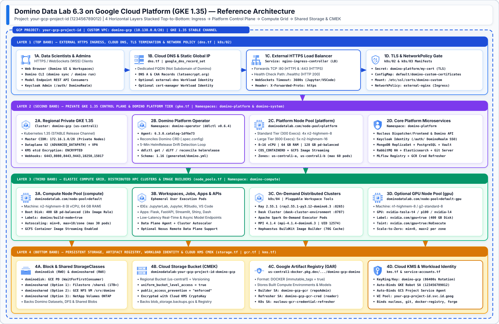
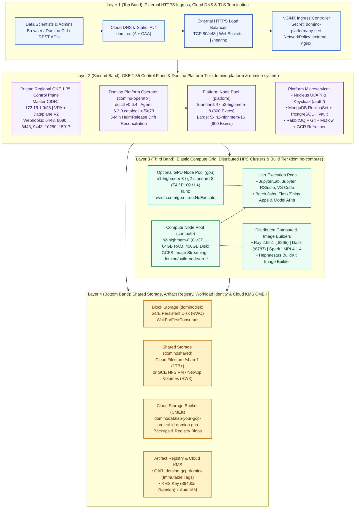
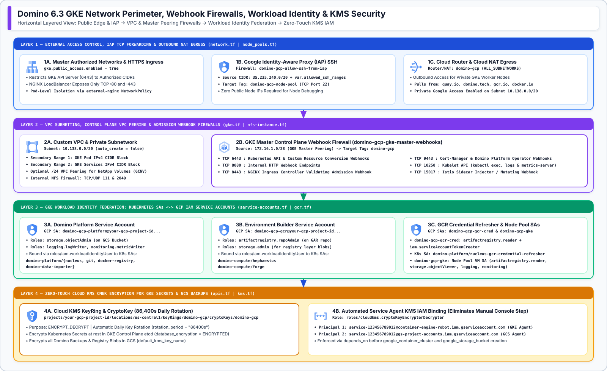
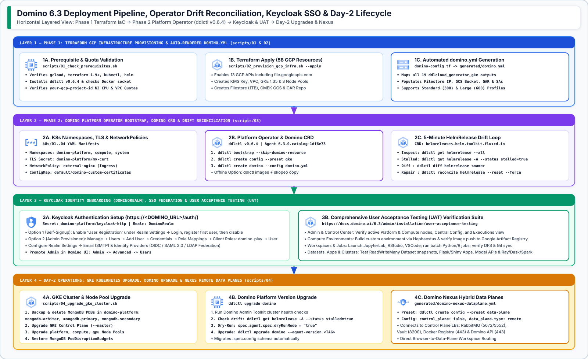
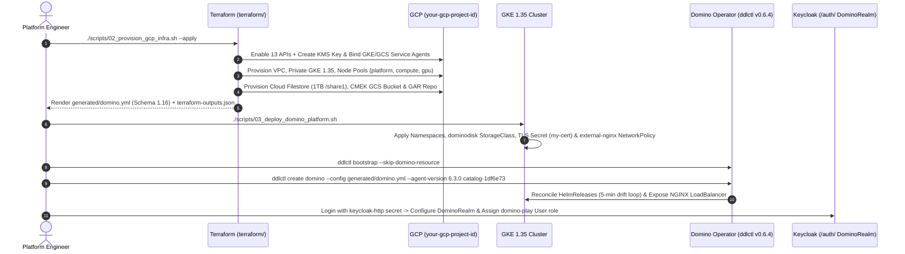

# Domino Data Lab 6.3 on Google Cloud Platform (GKE 1.35) — Terraform IaC & Deployment Suite

[](https://docs.domino.ai/6.3/admin/installation/manage-deployments/gcp/index)
[](https://cloud.google.com/kubernetes-engine)
[](https://github.com/dominodatalab/terraform-gcp-gke)
[](https://docs.domino.ai/6.3/admin/installation/releases)

Production-grade **Terraform Infrastructure-as-Code (IaC)**, **Kubernetes Manifests**, and **Automated Deployment Scripts** for provisioning **Domino Data Lab 6.3.0** (`fleetcommand-agent: 6.3.0.catalog-1df6e73`, `ddlctl: 0.6.4`) on **Google Kubernetes Engine (GKE 1.35)** in GCP project **`your-gcp-project-id`**.

---

## 1. End-to-End Reference Architecture (Horizontal Layered View)





---

## 2. Network Perimeter, Workload Identity & Zero-Touch KMS Security



| Security & Network Domain | Terraform Resource | Configuration Details |
| :--- | :--- | :--- |
| **VPC & Subnet** | `google_compute_network` / `subnetwork` | Custom VPC `domino-gcp`, Subnet `10.138.0.0/20`, `private_ip_google_access = true`, Cloud Router & Cloud NAT |
| **GKE Control Plane Webhooks** | `google_compute_firewall.master_webhooks` | Permits GKE Master (`172.16.1.0/28`) $\rightarrow$ Worker Nodes on TCP `6443`, `8080`, `8443`, `9443`, `10250`, `15017` |
| **IAP SSH Tunneling** | `google_compute_firewall.iap_tcp_forwarding` | Permits Google IAP (`35.235.240.0/20`) $\rightarrow$ `domino-gcp-node-pool` on TCP `22` (Zero public node IPs) |
| **Zero-Touch KMS CMEK** | `google_kms_crypto_key_iam_binding` | Auto-binds `roles/cloudkms.cryptoKeyEncrypterDecrypter` to both `service-123456789012@container-engine-robot.iam.gserviceaccount.com` and `service-123456789012@gs-project-accounts.iam.gserviceaccount.com` |
| **Platform Workload Identity** | `domino-gcp-platform` SA | Bound to `domino-platform/{nucleus, git, docker-registry, domino-data-importer}` (`roles/storage.objectAdmin`) |
| **Builder Workload Identity** | `domino-gcp-gcr` SA | Bound to `domino-compute/{hephaestus, forge}` (`roles/artifactregistry.repoAdmin`, `roles/storage.admin`) |
| **Credential Refresher WI** | `domino-gcp-gcr-cred` SA | Bound to `domino-platform/nucleus-gcr-credential-refresher` (`roles/artifactregistry.reader`, `serviceAccountTokenCreator`) |

---

## 3. Two-Phase Deployment Pipeline, Drift Loop & Day-2 Operations





---

## 4. Quick-Start Deployment Commands

```bash
# Step 1: Validate CLI tools (gcloud, terraform, kubectl, helm, ddlctl v0.6.4) & GCP quotas
./scripts/01_check_prerequisites.sh

# Step 2: Provision GKE 1.35, Cloud Filestore, CMEK GCS, GAR & render generated/domino.yml
./scripts/02_provision_gcp_infra.sh --apply

# Step 3: Configure GKE namespaces, TLS secret (domino-platform/my-cert), NetworkPolicies & Domino Operator
./scripts/03_deploy_domino_platform.sh

# Step 4: Run the 55-check automated verification suite
python3 ./tests/validate_all.py
```

---

## 5. Live Provisioned Environment (`your-gcp-project-id`)

| Resource Category | Live GCP Resource ID / Value | Status |
| :--- | :--- | :--- |
| **GKE Cluster** | `projects/your-gcp-project-id/locations/us-central1/clusters/domino-gcp` (`1.35.8-gke.1796000`, UUID `00000000-0000-4000-8000-000000000000`) | `RUNNING` |
| **Node Pools** | `platform` (`n2-standard-8`, 4 nodes Ready), `compute` (`n2-highmem-8`, GCFS image streaming), `gpu` (`n1-highmem-8`, T4 autoscaling 0–2) | `RUNNING` |
| **Cloud Filestore (RWX)** | `projects/your-gcp-project-id/locations/us-central1-a/instances/domino-gcp` (`10.42.0.10:/share1`, 1 TB) | `READY` |
| **CMEK GCS Bucket** | `gs://dominodatalab-your-gcp-project-id-domino-gcp` | `READY` |
| **Artifact Registry** | `us-central1-docker.pkg.dev/your-gcp-project-id/domino-gcp-domino` (Immutable Tags) | `READY` |
| **Cloud KMS CryptoKey** | `projects/your-gcp-project-id/locations/us-central1/keyRings/domino-gcp/cryptoKeys/domino-gcp` (`86400s` rotation + GKE & GCS Service Agent IAM) | `ENABLED` |
| **Domino K8s Primitives** | `domino-platform`, `domino-compute`, `domino-system` namespaces, `dominodisk` default StorageClass, `my-cert` TLS Secret, `external-nginx` NetworkPolicy, Distributed Compute & Custom Certs ConfigMaps | `ACTIVE` |

---

## 6. Repository Structure

| Path | Purpose |
| :--- | :--- |
| [`terraform/`](terraform/) | Complete Terraform IaC module for Domino 6.3 on GKE (`apis.tf`, `kms.tf`, `network.tf`, `gke.tf`, `node_pools.tf`, `storage.tf`, `nfs-instance.tf`, `gcnv.tf`, `service-accounts.tf`, `gcr.tf`, `gcr-credential-refresher.tf`, `dns.tf`, `domino-config.tf`, `outputs.tf`) |
| [`terraform/examples/gke-main.tf`](terraform/examples/gke-main.tf) | Reconstructed standalone `gke-main.tf` root caller matching `ddlcloud_generator_gke/v1_0.py` |
| [`generated/domino.yml`](generated/domino.yml) | Auto-rendered Domino 6.3 installer configuration (`schema: '1.16'`) populated with live `your-gcp-project-id` Terraform outputs |
| [`generated/domino-nexus-dataplane.yml`](generated/domino-nexus-dataplane.yml) | Auto-rendered Domino Nexus Remote GKE Data Plane configuration (`--preset data-plane`) |
| [`k8s/`](k8s/) | Declarative Kubernetes manifests: Namespaces, `dominodisk` StorageClass, `external-nginx` `NetworkPolicy`, `domino-custom-certificates` `ConfigMap`, and Ray/Dask/MPI Workspace Tools |
| [`scripts/`](scripts/) | End-to-end automation scripts (`01_check_prerequisites.sh` through `04_upgrade_gke_cluster.sh` + `generate_architecture_diagrams.py`) |
| [`docs/DOMINO_GCP_DEPLOYMENT_PLAN.md`](docs/DOMINO_GCP_DEPLOYMENT_PLAN.md) | Comprehensive architectural & operational runbook synthesizing all Domino 6.3 GCP docs & sublinks |
| [`tests/validate_all.py`](tests/validate_all.py) | Automated verification suite testing Terraform state, outputs, `domino.yml` schema, K8s manifests, and SVG/PNG assets |
